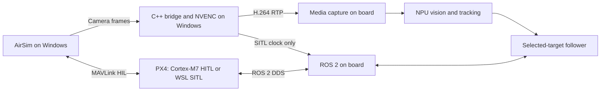

# Raven Simulation

AirSim scenarios and hardware-connected PX4/ROS validation for Raven. Windows renders the neighbourhood and runs the C++17 NVENC video sender; PX4 runs on the real Cortex-M7 in HITL, or in isolated WSL SITL tests; i.MX95 Linux decodes video and runs NPU detection, tracking and guidance.



## What is here

- `scenarios/*.jsonc`: scenario inputs. The C++ bridge generates AirSim scene, robot and trajectory JSONC files for each run, using the pinned upstream robot template.
- `src/`: AirSim client, scene generation, RTP/MP4 output and ROS clock bridge. PX4 controls the aircraft; only the car follows a script.
- `scripts/`: Windows installation, WSL SDK installation, board setup/restore and PX4 startup.
- `tests/`: opt-in Python `unittest` integration tests using the board's existing ROS packages. Python is only the validation harness.
- `results/`: small, sanitized validation summaries. Downloads, binaries, logs and recordings are excluded from Git.

Scenario profiles own the scene ID, aircraft spawn, target asset, visual alignment and route parameters. The shared client consumes generated bindings instead of assuming a particular car or scene name. Video, clock and PX4 lifecycle code stay shared. Each profile is discovered by CTest for offline validation; flight tests remain explicit and scenario-specific. The current `follow` test targets the street-loop car profile.

The `hitl-neighborhood` profile uses the packaged neighborhood streets, renders and records 1280×720, and sends a CUDA-downscaled 640×360 stream to the board. Real-time car fixtures use double-precision elapsed time in the host bridge, avoiding the packaged simulator's float-uptime trajectory quantization. PX4 continues to control the aircraft; fixture poses are never follower inputs.

The `hitl-suburban-pursuit` profile adds sweeping S-bends and a roundabout with three cars. A textured road is generated as glTF and imported through the simulator API; houses and trees use the packaged assets. Its following test requires 90 seconds, including the roundabout exit. Scene textures are pinned by hash in `scene-assets.json` and installed into the simulator data directory under `assets/` (CC0, [Poly Haven](https://polyhaven.com/license)). Pass that directory with `Start-Bridge.ps1 -AssetDirectory <DATA_DIRECTORY>/assets`. Offline CTest validates geometry without downloaded textures.

To add a scenario, add a profile under `scenarios/` and select it in the bridge command. Rounded rectangles and closed segment routes (lines, arcs and tangent Bezier transitions) are supported. New environments also require their assets to be installed in AirSim. This does not imply arbitrary actors or environments already work.

This uses **IAMAI ProjectAirSim v1.0.1**, the continuation linked by Microsoft's original AirSim project. Source and environment pins are in `versions.env`. The PX4 checkout must match Raven's `px4_msgs`; do not substitute an older PX4 release to match an example.

## Install

Windows 11, Ubuntu 22.04 in WSL 2, an NVIDIA GPU and a Raven board with ROS Jazzy, media-capture, vision-engine, target-tracker, guidance and MicroXRCEAgent are the validated arrangement. Configure SSH key access to the board first. No firmware is flashed by this repository.

Clone this repository in WSL and run:

```bash
git clone https://github.com/Swamy-BV/raven-simulation.git
cd raven-simulation
./scripts/install-wsl.sh
```

The script installs Ubuntu packages and builds the pinned C++ SDK into `.deps`. For already installed packages, use `SKIP_APT=1`. An optional first argument selects another dependency directory.

Use the Raven PX4 checkout and build its native SITL target:

```bash
export PX4_SOURCE_DIR=../PX4-Autopilot
git -C "$PX4_SOURCE_DIR" rev-parse HEAD  # must match PX4_COMMIT in versions.env
make -C "$PX4_SOURCE_DIR" px4_sitl_default
cmake -S . -B build -G Ninja -DCMAKE_BUILD_TYPE=Release \
  -DCMAKE_PREFIX_PATH="$PWD/.deps/cpp-sdk" -DPX4_SOURCE_DIR="$PX4_SOURCE_DIR"
cmake --build build --parallel
ctest --test-dir build --output-on-failure
```

From Windows PowerShell, run these scripts from a **Windows clone** of this repository. Keep the WSL clone for builds; Windows treats scripts on a WSL UNC path as remote files under its execution policy.

```powershell
.\scripts\Install-Windows.ps1 -Prerequisites
```

This installs the Microsoft Visual C++ and DirectX prerequisites and downloads the approximately 1.8 GB Neighborhood environment. It verifies the pinned SHA-256 before extraction. Downloads go to the current user's local application-data directory, not the repository. `-DataDirectory` selects another location; `-Archive` reuses an existing ZIP.

Get the WSL IPv4 address with `wsl -d Ubuntu-22.04 hostname -I`. In an **administrator PowerShell**, configure the narrowly scoped inbound rules:

```powershell
.\scripts\Enable-WslFirewall.ps1 -WslAddress <WSL_IPV4>
```

Rules allow only the simulator executable and that WSL address: TCP 4560/8989/8990 and UDP 14580. Repeat after a WSL address change. Start rendering in a normal PowerShell:

```powershell
.\scripts\Start-Simulator.ps1 -GraphicsAdapter 0
```

Select the NVIDIA adapter index on your machine; check GPU activity with `nvidia-smi`. Add `-Visible` for a simulator window. The default renders offscreen.

## Native Windows video

Use a Visual Studio 2022 Developer PowerShell with CMake and Ninja. Build the pinned ProjectAirSim 1.0.1 C++ SDK for Windows. Build Micro-CDR 2.0.1 and the PX4-pinned Micro-XRCE-DDS client with their superbuilds disabled, installing them to a shared prefix. Keep upstream source pins unchanged. Install the official GStreamer MSVC development package and a current NVENC-capable runtime; the official GStreamer Python wheels can supply the runtime without a machine-wide install.

Set `AIRSIM_SDK`, `XRCE_SDK` and `GSTREAMER_SDK` to those installation prefixes, then build the shared sender:

```powershell
cmake -S . -B build-windows -G Ninja -DCMAKE_BUILD_TYPE=Release `
  "-DCMAKE_PREFIX_PATH=$env:AIRSIM_SDK;$env:XRCE_SDK" "-DGSTREAMER_ROOT=$env:GSTREAMER_SDK"
cmake --build build-windows --parallel
```

After starting the simulator and the board's simulation agent, launch the native bridge:

```powershell
./scripts/Start-Bridge.ps1 -Executable ./build-windows/airsim-bridge.exe `
  -SimulatorHost <WINDOWS_SIMULATOR_ADDRESS> -BoardAddress <BOARD_IPV4> `
  -RobotTemplate <PINNED_PX4_ROBOT_TEMPLATE> -Scenario ./scenarios/street-drive.jsonc `
  -OutputDirectory ./run/driving-01 -GStreamerRoot <GSTREAMER_RUNTIME_PREFIX>
```

For the official wheel runtime, replace `-GStreamerRoot` with `-GStreamerPython <VENV_PYTHON>`. The small PowerShell launcher obtains the official runtime's DLL/plugin environment and launches the native C++ executable without a console window; it does not process frames in Python. Use the Windows WSL-network address for `SimulatorHost` when PX4 connects from WSL. Wait for `poses.jsonl`, then start PX4 and the explicit flight test from WSL as below. Windows generates `config/px4.env` with Unix line endings for that launcher.

Video goes directly from Windows to the board. Windows requires NVENC and never silently falls back to CPU encoding. Every run records `encoder.json`, acquisition/encoder timing logs and MP4 footage. The older Linux bridge remains available with its explicit software encoder; it is not the Windows GPU path. Stop PX4 after landing/disarming, then finalize the recording with:

```powershell
./scripts/Start-Bridge.ps1 -Stop -OutputDirectory ./run/driving-01
```

Offline review overlays use the recorded ROS tracks, selected identity, confidence, flight state and PX4 speed. Windows NVDEC/NVENC handles video decode/encode; Cairo draws annotations on the host. Boxes are held at most 200 ms with their age shown, and playback keeps the original wall-time cadence:

```powershell
<VENV_PYTHON> ./tests/render_review.py <RUN_DIRECTORY> <OBSERVATIONS_JSONL> <RESULT_JSON> <OUTPUT_MP4>
```

Add `--telemetry` to the review command for selected track ID and detection confidence, target estimates, input age, control timing, yaw error and a command-versus-PX4 speed graph. These use recorded ROS/PX4 logs; target speed and range remain explicitly labelled as estimates.

## Run

Set these values in each WSL terminal:

```bash
export BOARD_IP=<BOARD_IPV4>
export SIM_HOST=$(ip route show default | awk '{print $3; exit}')
export PX4_SOURCE_DIR=../PX4-Autopilot
```

1. Prepare the board. These changes live under `/run` and do not alter its read-only root filesystem:

   ```bash
   ./scripts/board.sh start "$BOARD_IP"
   ```

2. Start the bridge in one WSL terminal, using a new output directory for every run:

   ```bash
   ./build/airsim-bridge "$SIM_HOST" "$BOARD_IP" \
     .deps/ProjectAirSim/client/python/example_user_scripts/sim_config/robot_quadrotor_px4_sitl_wsl2.jsonc \
     scenarios/street-loop.jsonc run/session-01 600
   ```

3. **After the bridge reports that the scene is loaded**, start PX4 in another terminal:

   ```bash
   ./scripts/start-px4.sh "$PX4_SOURCE_DIR" "$SIM_HOST" "$BOARD_IP"
   ```

   Scene loading resets AirSim's simulator connection. Always start PX4 after loading a fresh scene. Instance 1 has system ID 2 and publishes under `/simulation`; the physical M7 keeps system ID 1 and `/fmu`.

4. Explicitly run one flight test from another terminal:

   ```bash
   ./scripts/run-flight-test.sh "$BOARD_IP" hover
   # For a fresh scene/PX4 session:
   ./scripts/run-flight-test.sh "$BOARD_IP" follow
   ```

   The tests check the vehicle identities and recent disarmed M7 telemetry before sending commands. They use normal arming checks, operate only on `/simulation`, and land/disarm during cleanup. Following selects a confident car track in the centre of the image. It does not use simulator ground truth as a target input or silently switch IDs. The follow test requires **25 simulated seconds** and deliberately fails if the selected track expires.

   Host MP4 plus timestamped ROS evidence are recorded by default. Board PNG snapshots are opt-in with `RAVEN_SIM_SNAPSHOTS=1`; the harness checks free space before creating flight-control publishers.

   Run each test in a fresh bridge/PX4 session. The street-loop profile holds the car for 60 simulated seconds, then moves at 0.4 m/s to match the current follower's 0.6 m/s speed limit. It is a road-loop perception/following scenario, not a vehicle-dynamics benchmark.

5. After the test lands and disarms, shut down in this order:

   ```bash
   ./scripts/stop-px4.sh "$PX4_SOURCE_DIR"
   # Ctrl+C in the bridge terminal finalizes the MP4.
   ./scripts/board.sh stop "$BOARD_IP"
   ```

   Finally run `Start-Simulator.ps1 -Stop` in Windows. Board stop restores the physical camera and leaves the follower stopped. Run only one simulation session at a time. `RAVEN_SIM_SSH_SOCKET` can select an existing OpenSSH control socket to reuse a board connection during a run.

`street-traffic.jsonc` requests **40 mph (17.8816 m/s)** cruising, accelerates at 3 m/s² and slows for corners using a 2 m/s² lateral limit. It includes two additional cars. The current follower is capped at 0.6 m/s and cannot keep up; this profile does not establish high-speed following. The historical low-speed result below used the earlier side-view profile. The current straight and turn profiles start behind the car.

For an installed optional detector, set `RAVEN_SIM_VISION_MODEL=yolov8m-neutron` when running `board.sh start`. The image must contain that model and a compatible vision-engine; the default remains unchanged when this option is omitted.

`panorama-overview.jsonc` is a target-free camera fixture in the installed Neighborhood environment. It uses a level, roll/pitch-stabilized camera and spawns at the road intersection used by the rear-turn profile. It does not create an empty-field environment, command a yaw sweep, capture a photo series or stitch images. Those steps need separate validation; no panorama flight has passed yet. A future panorama behavior should hold position through PX4, turn to overlapping capture angles and request photos from media-capture. Stitching remains a separate consumer of the images and capture poses.

`street-drive.jsonc` requests 5 m/s cruising with acceleration and corner-speed limits, a stabilized camera and matched projection geometry. Its `drive` flight test requires 40 simulated seconds, measured driving speed, identity-loss braking, hold and automatic landing; the latest run passed these flight checks. Its stricter rear-formation gate still fails during turns; see `results/windows-streaming-validation.json`.

The rear-follow profiles are staged by speed: `street-follow.jsonc` (0.1 m/s), `street-loop.jsonc` (0.4 m/s straight segment), then `street-turn.jsonc` (0.4 m/s compact turn). Each starts behind the eastbound target. Keep the same identity, timestamp and flight checks for every stage.

After collecting the board's `observations.jsonl` and `result.json` alongside the host run, evaluate them offline:

```bash
python3 tests/follow_metrics.py "$RUN" "$RUN/board/observations.jsonl" "$RUN/board/result.json" "$RUN/metrics.json"
```

The evaluator reports stand-off, cross-track error, behind-target fraction, trailing-bearing error, projection error, capture latency and pose timestamp skew. The rear-follow evaluator also requires the 95th-percentile trailing-bearing error to stay within 30 degrees. This checks rear formation separately from keeping the target visible. Actor poses are evaluation-only. A box footpoint estimates visible ground contact; the actor origin is a different reference point. Capture latency is separate from engagement-to-forward-motion delay: the latter starts at following activation and ends when measured velocity along the target's travel direction reaches 0.1 m/s. It is not a measure of response to every later target manoeuvre.

## M7 HITL bring-up

The local `raven_frdm_hitl` target runs PX4 on the physical M7 with external AirSim sensors and simulated motor outputs. ROS commands use system 1 under `/fmu`; WSL SITL is not involved. No physical PWM driver is compiled into this target.

The physical M7 passed normal arming, takeoff, a 10-second hover, **61 seconds of moving-car following** through two corners, identity-loss stop, automatic landing and disarm. The car waits five seconds after readiness, then requests 5 m/s cruising. Linux uses YOLOv8m on the NPU; Windows renders the scene. Corner centering and formation smoothness still need tuning. See `results/m7-hitl-validation.json`.

`hitl-racetrack.jsonc` adds a clear 500 x 300 m circuit with 110 m bends and three cars. The selected car waits five seconds after readiness, then cruises at 40 mph; other cars use adjacent lanes. The physical M7 followed it through the first bend for about 17 seconds after reaching cruising speed, with a measured car average of 40.0 mph. The 61-second gate failed on selected-identity loss, followed by automatic landing and disarm. YOLOv8s runs on the board's NPU; the close chase uses 4.5 m takeoff height and 8 m nominal stand-off. Yaw/association stability and full-minute following remain unfinished. See `results/racetrack-hitl-validation.json`.

For the deferred HITL car start, set `RAVEN_SIM_RUN_DIR` to the active bridge run directory when invoking `scripts/run-hitl-test.sh`. The harness creates the `start-target` marker after following is ready. Review recorded frames; AirSim's one-shot `GetImages` probe interrupts continuous capture.

## Results and limits

The 40 mph traffic profile reached **40.00 mph measured from live simulator positions** with two traffic cars present. PX4 SITL and the real M7 remained disarmed; high-speed following was not attempted. See `results/car-40mph-validation.json`.

The historical low-speed `street-follow.jsonc` profile passed **25.008 simulated seconds / 40.20 wall seconds** of selected-car following, then identity-loss hold, landing and disarm. The target speed was 0.1 m/s. A separate interrupted-camera test latched hold and landed, and five-second-old ROS images produced no detections. These do not validate the faster default loop, multiple cars, viewpoint changes or physical flight. See `results/timing-validation.json`; older baseline results remain historical evidence.

Capture/sender/ROS profiles request 30 fps; this is not a measured throughput guarantee. The latest Windows GPU/PX4 recording measured 26.77 fps in real time. Track simulation-time rate, real-time rate and review-video sampling separately.

Each bridge run saves `camera.mp4`, `frames.jsonl` (capture/host timing and sender queue occupancy), `encoded.jsonl` (encoder output timing), `clock.jsonl` (simulation clock sends), `poses.jsonl` and generated `config/`. Pose logs are evaluation evidence, not follower inputs. The RTP sender carries the original capture time using NTP-64; the board explicitly enables this shared simulation-clock policy.

For per-frame timing, start the board with `RAVEN_SIM_TRACE=1 ./scripts/board.sh start "$BOARD_IP"`. Save the four service journals for that single scene/boot as a text trace, then run:

```bash
python3 tests/analyze_timing.py run/timing.log --sender-run run/session-01
```

ROS source age and steady wall-time stage latency are reported separately. The two machines' steady clocks are not assumed synchronized. Simulation time uses an ordered, reliable XRCE clock stream with bounded history; lost Wi-Fi packets are repaired. This is separate from PTP/NTP host-clock synchronization. Guidance still rejects a control-clock step above 250 ms. A hold has no perception input and is traced with source timestamp zero. Future images can be rejected while asynchronous `/clock` updates catch up; never restamp them as fresh.

`tests/test_stale_input.py` is a separate opt-in board check: stop capture, restart inference/tracking, keep both PX4 instances disarmed, and set `RAVEN_SIM_STALE_INPUT=1`. It injects five-second-old ROS images and requires stale-input rejection without detections. Restore camera services afterward.

Offline checks need neither a board nor a running simulator:

```bash
ctest --test-dir build --output-on-failure
python3 -m unittest discover -s tests -v  # flight tests skip without explicit opt-in
shellcheck -x scripts/*.sh
clang-format --dry-run --Werror src/*.cpp src/*.h
```

The reorganized harness also passed its on-board hover test; installation and check details are in `results/harness-validation.json`. The later low-speed timing/following validation is recorded separately. A build or skipped hardware test is not a flight pass.

## License

Raven simulation code is AGPL-3.0-only. ProjectAirSim's SDK and robot templates remain under their upstream MIT license. The downloaded Unreal environment and dependencies retain their own licenses; they are not redistributed here.
