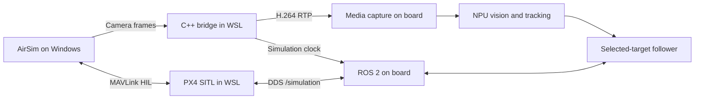

# Raven Simulation

AirSim scenarios and hardware-connected PX4/ROS validation for Raven. Windows renders the neighbourhood; PX4 SITL and the C++17 bridge run in WSL; the i.MX95 board decodes video and runs NPU detection, tracking and following.



## What is here

- `scenarios/*.jsonc`: scenario inputs. The C++ bridge generates AirSim scene, robot and trajectory JSONC files for each run, using the pinned upstream robot template.
- `src/`: AirSim client, scene generation, RTP/MP4 output and ROS clock bridge. PX4 controls the aircraft; only the car follows a script.
- `scripts/`: Windows installation, WSL SDK installation, board setup/restore and PX4 startup.
- `tests/`: opt-in Python `unittest` integration tests using the board's existing ROS packages. Python is only the validation harness.
- `results/`: small, sanitized validation summaries. Downloads, binaries, logs and recordings are excluded from Git.

Scenario profiles own the scene ID, aircraft spawn, target asset, visual alignment and route parameters. The shared client consumes generated bindings instead of assuming a particular car or scene name. Video, clock and PX4 lifecycle code stay shared. Each profile is discovered by CTest for offline validation; flight tests remain explicit and scenario-specific. The current `follow` test targets the street-loop car profile.

To add a scenario, add a profile under `scenarios/` and select it in the bridge command. Rounded-rectangle routes are currently supported; new route types need a generator in `src/scenario.cpp`. New environments also require their assets to be installed in AirSim. This does not imply arbitrary actors or environments already work.

This uses **IAMAI ProjectAirSim v1.0.1**, the continuation linked by Microsoft's original AirSim project. Source and environment pins are in `versions.env`. The PX4 checkout must match Raven's `px4_msgs`; do not substitute an older PX4 release to match an example.

## Install

Windows 11, Ubuntu 22.04 in WSL 2, an NVIDIA GPU and a Raven board with ROS Jazzy, media-capture, vision-engine, target-tracker, target-follower and MicroXRCEAgent are the validated arrangement. Configure SSH key access to the board first. No firmware is flashed by this repository.

Clone this repository in WSL and run:

```bash
git clone https://github.com/Swamy-BV/raven-simulation.git
cd raven-simulation
./scripts/install-wsl.sh
```

The script installs Ubuntu packages and builds the pinned C++ SDK into `.deps`. For already installed packages, use `SKIP_APT=1`. An optional first argument selects another dependency directory.

Use the Raven PX4 checkout and build its native SITL target:

```bash
export PX4_SOURCE_DIR=../PX4-Autopilot
git -C "$PX4_SOURCE_DIR" rev-parse HEAD  # must match PX4_COMMIT in versions.env
make -C "$PX4_SOURCE_DIR" px4_sitl_default
cmake -S . -B build -G Ninja -DCMAKE_BUILD_TYPE=Release \
  -DCMAKE_PREFIX_PATH="$PWD/.deps/cpp-sdk" -DPX4_SOURCE_DIR="$PX4_SOURCE_DIR"
cmake --build build --parallel
ctest --test-dir build --output-on-failure
```

From Windows PowerShell, run these scripts from a **Windows clone** of this repository. Keep the WSL clone for builds; Windows treats scripts on a WSL UNC path as remote files under its execution policy.

```powershell
.\scripts\Install-Windows.ps1 -Prerequisites
```

This installs the Microsoft Visual C++ and DirectX prerequisites and downloads the approximately 1.8 GB Neighborhood environment. It verifies the pinned SHA-256 before extraction. Downloads go to the current user's local application-data directory, not the repository. `-DataDirectory` selects another location; `-Archive` reuses an existing ZIP.

Get the WSL IPv4 address with `wsl -d Ubuntu-22.04 hostname -I`. In an **administrator PowerShell**, configure the narrowly scoped inbound rules:

```powershell
.\scripts\Enable-WslFirewall.ps1 -WslAddress <WSL_IPV4>
```

Rules allow only the simulator executable and that WSL address: TCP 4560/8989/8990 and UDP 14580. Repeat after a WSL address change. Start rendering in a normal PowerShell:

```powershell
.\scripts\Start-Simulator.ps1 -GraphicsAdapter 0
```

Select the NVIDIA adapter index on your machine; check GPU activity with `nvidia-smi`. Add `-Visible` for a simulator window. The default renders offscreen.

## Run

Set these values in each WSL terminal:

```bash
export BOARD_IP=<BOARD_IPV4>
export SIM_HOST=$(ip route show default | awk '{print $3; exit}')
export PX4_SOURCE_DIR=../PX4-Autopilot
```

1. Prepare the board. These changes live under `/run` and do not alter its read-only root filesystem:

   ```bash
   ./scripts/board.sh start "$BOARD_IP"
   ```

2. Start the bridge in one WSL terminal, using a new output directory for every run:

   ```bash
   ./build/airsim-bridge "$SIM_HOST" "$BOARD_IP" \
     .deps/ProjectAirSim/client/python/example_user_scripts/sim_config/robot_quadrotor_px4_sitl_wsl2.jsonc \
     scenarios/street-loop.jsonc run/session-01 600
   ```

3. **After the bridge reports that the scene is loaded**, start PX4 in another terminal:

   ```bash
   ./scripts/start-px4.sh "$PX4_SOURCE_DIR" "$SIM_HOST" "$BOARD_IP"
   ```

   Scene loading resets AirSim's simulator connection. Always start PX4 after loading a fresh scene. Instance 1 has system ID 2 and publishes under `/simulation`; the physical M7 keeps system ID 1 and `/fmu`.

4. Explicitly run one flight test from another terminal:

   ```bash
   ./scripts/run-flight-test.sh "$BOARD_IP" hover
   # For a fresh scene/PX4 session:
   ./scripts/run-flight-test.sh "$BOARD_IP" follow
   ```

   The tests check the vehicle identities and recent disarmed M7 telemetry before sending commands. They use normal arming checks, operate only on `/simulation`, and land/disarm during cleanup. Following selects a confident car track in the centre of the image. It does not use simulator ground truth as a target input or silently switch IDs. The follow test requires **25 simulated seconds** and deliberately fails if the selected track expires.

   Run each test in a fresh bridge/PX4 session. The street-loop profile holds the car for 60 simulated seconds, then moves at 0.4 m/s to match the current follower's 0.6 m/s speed limit. It is a road-loop perception/following scenario, not a vehicle-dynamics benchmark.

5. After the test lands and disarms, shut down in this order:

   ```bash
   ./scripts/stop-px4.sh "$PX4_SOURCE_DIR"
   # Ctrl+C in the bridge terminal finalizes the MP4.
   ./scripts/board.sh stop "$BOARD_IP"
   ```

   Finally run `Start-Simulator.ps1 -Stop` in Windows. Board stop restores the physical camera and leaves the follower stopped. Run only one simulation session at a time.

## Results and limits

The initial bench validation passed PX4 takeoff, 4.5 m hover, landing, disarm and end-to-end follower activation. Following lasted about **8 wall-clock seconds / 4 simulated seconds**, with 0.47 m movement, before the selected track expired. The aircraft held and landed; the real M7 stayed disarmed. **Sustained following is not passing yet.** See `results/initial-bringup.json`.

Capture/sender/ROS profiles request 30 fps; this is not a measured throughput guarantee. The last full PX4 recording measured about 17.4 fps in real time. Track simulation-time rate, real-time rate and review-video sampling separately.

Each bridge run saves `camera.mp4`, `frames.jsonl` (source simulation timestamp and MP4 presentation timestamp), `poses.jsonl` and the generated `config/`. Board test artifacts are under `/tmp/raven-simulation-results/`. Pose logs are evaluation evidence, not inputs to the follower.

Offline checks need neither a board nor a running simulator:

```bash
ctest --test-dir build --output-on-failure
python3 -m unittest discover -s tests -v  # flight tests skip without explicit opt-in
shellcheck -x scripts/*.sh
clang-format --dry-run --Werror src/*.cpp src/*.h
```

The reorganized harness also passed its on-board hover test; installation and check details are in `results/harness-validation.json`. Sustained following has not been rerun after reorganization. A build or skipped hardware test is not a flight pass.

## License

Raven simulation code is AGPL-3.0-only. ProjectAirSim's SDK and robot templates remain under their upstream MIT license. The downloaded Unreal environment and dependencies retain their own licenses; they are not redistributed here.
